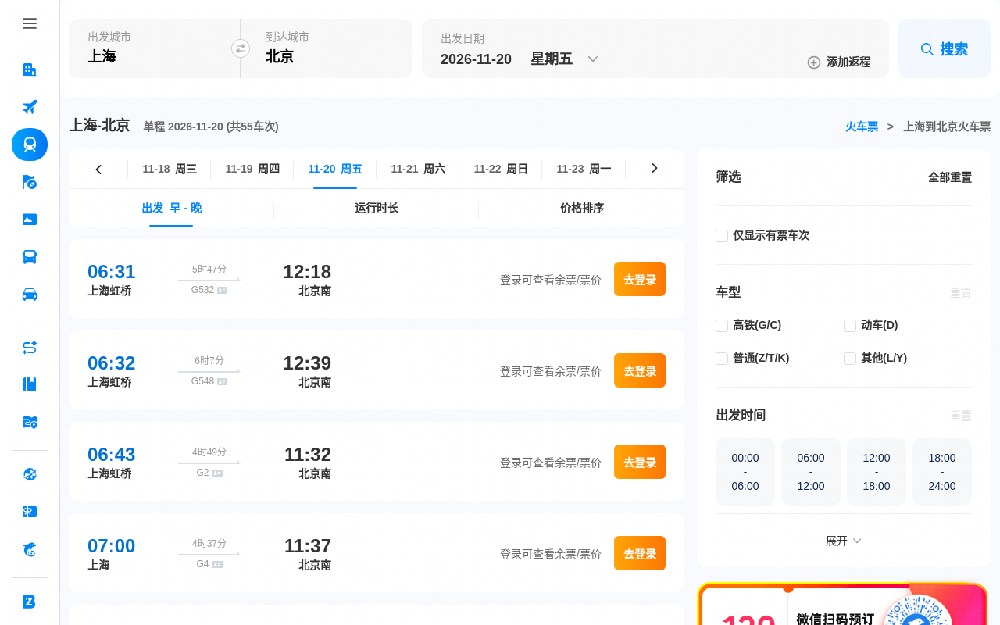

# project3：通用浏览器自动化智能体（基于 OpenManus 架构）

用 Python + LangGraph + Playwright + 视觉模型 + OpenSandbox + MCP 实现的通用智能体：
接收自然语言任务后，自主规划、操作浏览器、执行代码、读写文件，直到给出最终答案。

所有代码按执行/学习顺序以「序号_功能名.py」命名，每个文件自带 `__main__` 验证。

## 架构

```
用户任务
   │
   ▼
┌─────────────────────────────────────────────────────┐
│ 04_agent_graph.py  LangGraph 三层状态机              │
│   Planner（拆子任务）→ Executor（ReAct 执行）         │
│        ↑          ↓                                  │
│   重规划      Reviewer（审查结果，pass/fail）          │
└──────┬───────────────┬────────────────┬─────────────┘
       │               │                │
       ▼               ▼                ▼
 浏览器工具        视觉定位兜底        代码执行沙箱
 01_browser_      03_vision_         05_sandbox.py
 tools.py         locator.py         OpenSandbox(Docker)
 (Playwright      (截图→omni-flash    └─ 兜底 subprocess
  +stealth)       →坐标→click_xy)      +rlimit 限额
       │
       └────── 工具解耦（MCP 协议，独立子进程）──────
       ▼               ▼                ▼
 mcp_servers/   mcp_servers/     mcp_servers/
 browser_       filesystem_      search_server.py
 server.py      server.py        (必应轻量抓取)
       └────────── 06_mcp_client.py（MCP Host 统一接入）
```

## 文件清单

| 文件 | 说明 | 验证要点 |
|---|---|---|
| `01_browser_tools.py` | Playwright 封装：stealth、DOM 编号提取、click/type/scroll/截图 | 必应搜索全流程 |
| `02_react_agent.py` | ReAct 单智能体：qwen3.8-2.4t-a95b + 13 个 tool_calls 工具闭环（含 click_text/select_option/check/wait_for/switch_tab/pause_for_human） | 4 步完成搜索取标题 |
| `03_vision_locator.py` | 视觉定位兜底：截图→qwen3.8-omni-flash→像素坐标→坐标点击 | 纯视觉定位搜索框 (640,185) |
| `04_agent_graph.py` | LangGraph Planner/Executor/Reviewer 状态机，支持重规划；可注入领域提示词 | 4 子任务链路全 PASS |
| `05_sandbox.py` | OpenSandbox 代码执行沙箱，容器级隔离；subprocess+rlimit 兜底 | 沙箱内写文件宿主机不可见 |
| `06_mcp_client.py` | MCP Host：stdio 拉起 3 个工具服务，schema 转 OpenAI 格式跑 ReAct | 搜索+写文件链路 |
| `07_ctrip_agent.py` | 携程订票/订房：确定性流程（城市→日期→搜索→本地解析车次），含登录态持久化、支付安全闸门、`--agent` 自主模式 | 火车票查询取到最早三趟车次 |
| `mcp_servers/browser_server.py` | 浏览器工具 MCP 服务（6 个工具） | 由 06 托管验证 |
| `mcp_servers/filesystem_server.py` | 文件读写 MCP 服务（限 project3 根目录，防路径逃逸） | 由 06 托管验证 |
| `mcp_servers/search_server.py` | 必应搜索 MCP 服务（httpx 轻量抓取，不占浏览器） | 由 06 托管验证 |

## 演示效果

携程火车票查询（`07_ctrip_agent.py`，不需要登录，也不会调用大模型）：

```bash
python3 07_ctrip_agent.py --mode train --from 上海 --to 北京 --date 2026-11-20
```

终端输出：

```
  城市: 上海 → 北京   日期: 2026-11-20
  日期选择: 成功（出发日期 2026-11-20 星期五 添加返程）
  点击搜索...
    点候选搜索按钮「搜索」button @(1185,324)
    搜索生效（结果页出现「余票」）
  结果页: 上海到北京火车票预订与代购-高铁票价,动车票价-...

[最早出发的三趟车次]（本地解析，未调用大模型）
  G532  06:31-12:18  上海虹桥-北京南  5时47分
  G548  06:32-12:39  上海虹桥-北京南  6时7分
  G2  06:43-11:32  上海虹桥-北京南  4时49分
```



> 截图为未登录状态：携程只展示车次与时刻，票价需要登录后才可见，因此程序不输出票价，
> 也不会让模型去猜。

## 踩坑排查

这些是实际调试中遇到的问题，按出现顺序排列：

| 现象 | 根因 | 处理 |
|---|---|---|
| 点了「搜索」页面没反应 | 页头和表单各有一个「搜索」，点到了页头那个 | 取页面最靠下的搜索按钮按坐标点击，点完验证「余票」出现，失败再退化到 Enter / 视觉定位 |
| 城市被填成「北京北」 | 下拉候选是「北京\\nbeijing」「北京北\\nbeijingbei」，按文字包含匹配会命中后者 | 改为按首行完全匹配的 `select_suggestion` |
| 日历点不到目标日期 | 日历格子只有纯数字，没有「11月5日」这类文案 | `click_nth("5", 0, exact=True)` 按数字点 |
| `Execution context was destroyed` | 页面跳转瞬间调用 `evaluate` | 包装成返回空值，由下一轮重新获取 |
| 填了城市但搜索仍是旧城市 | 携程表单是 React 受控组件，直接改 value 不触发 onChange | 逐字 `type(delay=80)`，并校验控件当前值 |
| 同一命令重复提示「城市未成功设置」 | `_input_value` 被批量替换误改成递归调用自身，异常被吞掉后恒返回空串 | 改为读取 `value`/`innerText`，并修正调用点 |
| 大模型输出的票价是编的 | 未登录页面只显示「登录可查看余票/票价」 | 改为本地正则解析车次，不输出票价；大模型归纳改为可选 |
| `Free quota exhausted` 403 | 百炼账号开启「仅使用免费额度」且额度耗尽 | 关闭该模式，或用 `AGENT_MODEL` 换模型 |

## 环境与启动

> 下文命令里的 `/home/zkx456/other/bin/python3.13` 是作者本机的解释器路径，
> 请替换成你自己的 `python3`。依赖见 `requirements.txt`，首次运行需执行
> `pip install -r requirements.txt && playwright install chromium`。

```bash
# Python 解释器（依赖已装：playwright/langgraph/mcp/dashscope/openai/opensandbox）
/home/zkx456/other/bin/python3.13

# DashScope API Key（工作空间 sk-ws- key，代码会从 ~/.bashrc 兜底读取）
export DASHSCOPE_API_KEY=sk-...

# 阶段5的沙箱服务（仅 05_sandbox.py 需要，其余阶段不依赖）
# SQLite 存储在 project3/.opensandbox/（可写目录），避免默认 ~/.opensandbox 权限问题
cd project3
OPENSANDBOX_INSECURE_SERVER=YES opensandbox-server \
  --config ~/.sandbox.toml \
  > .opensandbox/server.log 2>&1 &
```

逐个验证（每个文件直接运行即可）：

```bash
cd project3
/home/zkx456/other/bin/python3.13 01_browser_tools.py
/home/zkx456/other/bin/python3.13 02_react_agent.py
/home/zkx456/other/bin/python3.13 03_vision_locator.py
/home/zkx456/other/bin/python3.13 04_agent_graph.py
/home/zkx456/other/bin/python3.13 05_sandbox.py   # 需先启动 opensandbox-server
/home/zkx456/other/bin/python3.13 06_mcp_client.py
```

可配环境变量：`AGENT_MODEL`（决策模型）、`VISION_MODEL`（视觉模型）、
`AGENT_PROFILE_DIR`（浏览器登录态目录）、`SANDBOX_IMAGE`（沙箱镜像）、
`OPENSANDBOX_URL`（沙箱服务地址）。

### 可视化：实时看浏览器操作过程

默认 headless 模式看不到窗口。加这两个环境变量即可弹出真实 Chromium 窗口、放慢动作：

```bash
# AGENT_HEADLESS=0  弹出真实窗口（不设则为无头模式）
# AGENT_SLOW_MO=800 每个浏览器动作后延迟 800ms，便于肉眼观察（毫秒）
AGENT_HEADLESS=0 AGENT_SLOW_MO=800 \
  /home/zkx456/other/bin/python3.13 02_react_agent.py
```

适用 01/02/04 三个会操作浏览器的阶段，03 是视觉定位本身也要看画面。

### 重启后快速开始

```bash
# 1. 确认环境变量（若 .bashrc 已配则自动加载）
echo $DASHSCOPE_API_KEY

# 2. 启动 OpenSandbox（仅阶段5 需要）
cd /media/zkx456/系统/ai课件/project3
OPENSANDBOX_INSECURE_SERVER=YES opensandbox-server --config ~/.sandbox.toml \
  > .opensandbox/server.log 2>&1 &

# 3. 直接跑任意阶段
/home/zkx456/other/bin/python3.13 01_browser_tools.py
```

## 携程订票 / 订房（07_ctrip_agent.py）

为什么不走"让大模型一步步点页面"：携程表单是自定义组件，每个动作都要等一次模型响应
（10～50 秒），既慢又会在中途重复输入、卡在某个字段。因此默认由**代码直接跑固定流程**，
车次结果用**本地正则解析**（零成本、无幻觉，不需要 API Key）；
`--llm` 才额外调用大模型做归纳。

```bash
cd /media/zkx456/系统/ai课件/project3

# 火车票：城市 → 日期 → 搜索 → 本地解析最早三趟（不花钱）
/home/zkx456/other/bin/python3.13 -u 07_ctrip_agent.py \
  --mode train --from 上海 --to 北京 --date 2026-11-20 --slow-mo 300

# 酒店：首次先登录一次（登录态存 project3/.browser_profile）
/home/zkx456/other/bin/python3.13 -u 07_ctrip_agent.py --login
/home/zkx456/other/bin/python3.13 -u 07_ctrip_agent.py \
  --mode hotel --city 上海 --checkin 2026-11-20 --checkout 2026-11-22 --slow-mo 300

# 大模型自主模式（慢，每步等一次模型响应，需要 API 额度）
/home/zkx456/other/bin/python3.13 -u 07_ctrip_agent.py \
  --mode train --agent --task "查11月20日上海到北京最早三趟高铁" --slow-mo 500
```

参数：`--mode train|hotel`、`--from/--to/--date`、`--city/--checkin/--checkout`、
`--llm`（归纳结果）、`--agent --task`（自主模式）、`--login`、`--profile`、
`--headless`（默认弹真实窗口）、`--slow-mo`（动作间隔毫秒）。日期必须 `YYYY-MM-DD`。

流程里的几个关键处理（都踩过坑）：

- **城市**：先清空再逐字输入，等下拉出现后用 `select_suggestion` 按**首行**匹配选「北京」。
  携程候选是「北京\nbeijing」「北京北\nbeijingbei」，用 `click_text` 会点到「北京北」。
- **日期**：点「出发日期」打开日历，日历格子只有纯数字，用 `click_nth("5", 0, exact=True)`。
- **搜索按钮**：页头和表单各有一个「搜索」，点到页头那个没反应。现在取页面**最靠下**的
  搜索按钮并按坐标点击，点完立刻验证结果页出现「余票/二等座」；失败退化为在输入框按
  Enter，再退化为截图交视觉模型定位按钮。
- **页面跳转容错**：`elements()` / `page_text()` 在跳转瞬间会抛
  `Execution context was destroyed`，已改为返回空列表/空串，由调用方下一轮重取。
- **登录态**：`launch_persistent_context` 复用 `project3/.browser_profile`，
  登录一次后续免登录（酒店搜索会强制跳登录页，`--login` 先做一次）。

**安全边界**：`07` 只做到搜索页 / 订单填写页。`--agent` 模式下还有代码级闸门：
命中「提交订单 / 确认支付 / 去支付 / 收银台」等关键词，或页面标题进入支付环节，
一律拦截并转 `pause_for_human`，交人工核对下单与付款。

## 技术选型理由

**决策模型 qwen3.8-2.4t-a95b（阿里百炼 OpenAI 兼容端点，当前默认）**
原先用 deepseek-v4-pro-0813，免费额度耗尽后切换到 qwen3.8-2.4t-a95b，
原生 tool_calls 实测正常，按 token 计费单价低、国内直连。
需要换回或换别的模型，设 `AGENT_MODEL` 环境变量即可，代码无需改动。

**视觉模型 qwen3.8-omni-flash**
探测 16 个候选后唯一可用：VL 系列全部 403（未授权/免费额度耗尽），
omni-flash 文本+图像均通且截图坐标定位实测准确。代码留 `VISION_MODEL`
环境变量，开通 qwen3-vl-plus（GUI 定位精度更高）后可无缝切换。

**DOM + Vision 双重定位**
DOM 编号定位是主路径（便宜、快、准）；当 click 返回 ok=false
（弹窗/canvas/反爬注入等 DOM 失效场景），自动截图交给视觉模型返回
像素坐标，用 mouse.click 兜底。视觉调用按 token 计费（约 1-2k/次），
故只在失败时触发，不进主循环。

**沙箱选 OpenSandbox（阿里开源）而非手搓 Docker / CubeSandbox**
容器级隔离 + REST/SDK 管理 + 资源限额开箱即用，比自己维护 docker run
脚本可靠；相比 CubeSandbox 部署更轻（单进程 server + 本地 Docker），
且提供 `docker-zh` 配置走阿里云镜像仓库，解决 docker.io 直连被墙问题。
服务不可达时降级 subprocess + rlimit（CPU 10s / 内存 512MB），主流程不中断。

**MCP 协议解耦工具层**
browser/filesystem/search 拆为独立 MCP Server 子进程，工具发现与调用
走标准协议，新增工具服务不改主流程代码；LLM 侧把 MCP schema 转成
OpenAI function calling 格式即可复用 ReAct 循环。

## 已知边界

- 百度对 headless 按 IP+行为风控（弹安全验证页），测试统一用必应
- OpenSandbox 的 SQLite 存储路径需在可写目录（本项目配在 `project3/.opensandbox/`）
- 携程火车票首页有**两个**「搜索」（页头入口 + 表单按钮），点页头那个无反应；
  `07` 已改为点最靠下的表单按钮并校验结果
- 携程会把上次搜索条件（城市/日期）写进本地缓存，表单打开时就是已填状态；
  `07` 按坐标位置识别输入框，不依赖"目的地"这类空占位文字
- 携程酒店搜索会强制跳转 `passport.ctrip.com`，必须先 `--login` 登录一次；
  `07` 的酒店链路到日期/目的地/点击搜索已修通，登录后的结果页取数需人工登录后再验证
- 遇到滑块/短信验证码：程序会调 `pause_for_human` 暂停，在窗口里人工完成后回车继续；
  非 TTY（后台运行）时该暂停自动跳过
- 提交订单与支付永不自动执行，只做到订单填写页
- 携程**未登录时只展示车次与时刻，不展示票价**（页面提示「登录可查看余票/票价」）；
  程序因此不输出票价，需要票价请先 `--login` 登录
- 项目 01-06 阶段依赖大模型（`DASHSCOPE_API_KEY`）；07 的确定性火车票流程不需要，
  只有 `--llm` / `--agent` 才调用模型
- 百炼账号若开启「仅使用免费额度」且额度耗尽，会返回 `403 Free quota exhausted`，
  需在控制台关闭该模式或改用其他模型
